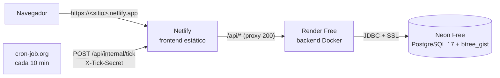

# Despliegue en producción

Pasos reproducibles para desplegar Estudio Sonrisa en planes gratuitos. La decisión y sus límites están en [DD-16](../knowledge-base/09_decisiones_y_supuestos.md) y los criterios en [12_despliegue_y_entornos.md](../knowledge-base/12_despliegue_y_entornos.md).

> Nunca escribas secretos reales en este archivo, en el repositorio, en issues ni en el handoff. Los valores viven solo en el panel de cada proveedor.

## Arquitectura



- El navegador ve **un solo origen** (Netlify). Las cookies del backend quedan como cookies de primera parte (DD-03).
- El cron pasa por Netlify, igual que el navegador, así que también prueba el reenvío. Mantiene despierto a Render, que se apaga a los 15 minutos sin tráfico.
- El backend aplica las migraciones de Flyway al arrancar. `V1__extensiones.sql` crea `btree_gist`.

## 1. Base de datos (Neon)

1. Crear un proyecto en [neon.com](https://neon.com) con Postgres 17, en la región más cercana a la del backend (por ejemplo, AWS `us-east-1` si Render usa Virginia/Ohio).
2. En **Connection details**, desactivar *Connection pooling* para obtener el **endpoint directo**. Flyway necesita sesiones normales.
3. Armar las variables para Render:
   - `SPRING_DATASOURCE_URL` = `jdbc:postgresql://<host-directo>.neon.tech/<base>?sslmode=require`
   - `SPRING_DATASOURCE_USERNAME` y `SPRING_DATASOURCE_PASSWORD`, de la misma pantalla.

## 2. Backend (Render)

1. **New → Web Service** desde el repositorio de GitHub, con rama `main`.
2. Configuración:
   - Language: **Docker**, con Root Directory `backend` (usa `backend/Dockerfile`).
   - Instance type: **Free**.
   - Health Check Path: `/api/health`.
   - Auto-Deploy: activado (cada merge a `main` despliega).
3. Generar el secreto del tick en una terminal propia y pegarlo directo en Render:

   ```powershell
   [Convert]::ToBase64String((1..32 | ForEach-Object { Get-Random -Maximum 256 }) -as [byte[]])
   ```

4. Variables de entorno (**Environment**). `SPRING_PROFILES_ACTIVE=prod` ya viene en la imagen y Render inyecta `PORT`.

   | Variable | Valor |
   |---|---|
   | `SPRING_DATASOURCE_URL` / `USERNAME` / `PASSWORD` | Los de Neon (paso 1) |
   | `APP_BASE_URL` | URL pública de Netlify (paso 3). Mientras no exista, cualquier URL `https://` provisoria |
   | `APP_MAIL_FROM` | `Estudio Sonrisa <no-reply@example.invalid>` hasta C-05 |
   | `APP_MAIL_DAILY_QUOTA` | `300` |
   | `APP_INTERNAL_TICK_SECRET` | El secreto generado |
   | `APP_ADMIN_EMAIL` / `APP_ADMIN_PASSWORD` | Administrador SaaS inicial. Contraseña larga y única |

   No hacen falta `SPRING_MAIL_*` hasta C-05: Render Free bloquea el SMTP saliente.
5. Anotar la URL del servicio, por ejemplo `https://turnos-backend.onrender.com`.

**Si el arranque falla**, en **Logs**:
- `Faltan variables de entorno obligatorias para el perfil 'prod': …` → cargar las que nombra.
- Error de conexión o de SSL con la base → revisar `sslmode=require` y que el host sea el endpoint directo.
- `Container ran out of memory` → ver la memoria en **Metrics**. Los flags de la JVM están en el `Dockerfile` (`JAVA_TOOL_OPTIONS`).

## 3. Frontend (Netlify)

1. En `frontend/public/_redirects`, la primera regla tiene que apuntar al host de Render del paso 2:
   `/api/*  https://<servicio>.onrender.com/api/:splat  200`. Es un cambio versionado y entra por PR.
2. **Add new site → Import from Git**, con rama `main` y Base directory `frontend`. El resto lo toma de `frontend/netlify.toml` (build `npm ci && npm run build`, publicación `dist`, Node 22).
3. Anotar la URL pública (`https://<sitio>.netlify.app`) y actualizar `APP_BASE_URL` en Render.

## 4. Cron externo (cron-job.org)

1. Crear un cronjob:
   - URL `https://<sitio>.netlify.app/api/internal/tick`, cada **10 minutos**.
   - En **Advanced**: método `POST` y header `X-Tick-Secret` con el secreto.
   - Notificaciones: avisar por email cuando falle.
2. En el historial, las respuestas tienen que ser **204**. Un 401 indica que el secreto no coincide.

**Rotar el secreto**: generar uno nuevo, actualizarlo en Render (se redespliega) y enseguida en cron-job.org. Entre los dos pasos, algún tick puede dar 401, y eso no tiene impacto.

## 5. Verificación

```powershell
curl.exe -i https://<sitio>.netlify.app/api/health
```
Tiene que responder `200` con `{"status":"UP"}`.

```powershell
curl.exe -i https://<sitio>.netlify.app/panel
```
Tiene que devolver `index.html` (el *fallback* SPA).

```powershell
curl.exe -i -X POST https://<sitio>.netlify.app/api/internal/tick
```
Tiene que responder `401` con `application/problem+json`.

**Cookie de primera parte** (manual, en el navegador):
1. Abrir `https://<sitio>.netlify.app/api/internal/cookie-probe`. Tiene que mostrar `{"received":false}`.
2. Recargar. Tiene que mostrar `{"received":true}`.
3. En DevTools → Application → Cookies, `cookie_probe` figura en el dominio de Netlify con `SameSite=Lax`, `Secure` y `HttpOnly`.

**Base**: en la consola SQL de Neon,
```sql
SELECT extname FROM pg_extension WHERE extname = 'btree_gist';
SELECT version, description FROM flyway_schema_history ORDER BY installed_rank;
```

**Memoria**: en Render → Metrics, la memoria en reposo tiene que quedar por debajo de 512 MB con margen. Valor medido en el primer despliegue: _(pendiente)_.

## Si cambia un plan gratuito

| Pieza | Reemplazo | Qué cambiar |
|---|---|---|
| Netlify | Cualquier hosting estático con proxy 200 hacia un dominio externo. En Cloudflare Pages hace falta un Worker o una Pages Function | `_redirects` o su equivalente |
| Render | Cualquier servicio de contenedores con 512 MB o más y HTTPS | Solo variables: la imagen es la misma |
| Neon | Cualquier PostgreSQL 15 o superior con `btree_gist` y sin pausa larga | `SPRING_DATASOURCE_*`. Migrar los datos con `pg_dump`/`pg_restore` cifrado (PA-13) |
| cron-job.org | Cualquier cron HTTP que permita `POST` con headers | Solo la configuración del cron |

## Fuentes (relevadas el 2026-11-28)

- [Render: bloqueo de SMTP en el plan Free](https://render.com/changelog/free-web-services-will-no-longer-allow-outbound-traffic-to-smtp-ports)
- [Neon: extensión btree_gist](https://neon.com/docs/extensions/btree_gist)
- [Neon vs Supabase, planes gratuitos](https://neon.com/guides/neon-vs-supabase-free-plan)
- [State of Free Hosting 2026](https://snapdeploy.dev/state-of-free-hosting)
- [Free Docker Hosting in 2026](https://dev.to/flisk/free-docker-hosting-in-2026-10-options-and-the-catch-for-each-1j42)
- [Comparativa de redirects estáticos por plataforma](https://gist.github.com/alpha14/9e6078979ae3b2df9201b49bbe7c9fc3)
